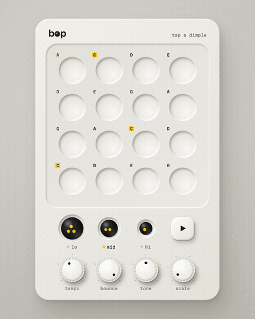

# bop

A bouncing-ball instrument. Three rubber balls hop across a tray of sixteen dimples, and every landing plays that dimple's note. A ball keeps travelling in whatever direction you last sent it, bouncing off the walls, so one tap turns into a loop: the melody and the rhythm both come from the geometry.

**Play it: https://bop-wustep.vercel.app**



[Watch it with sound](docs/bop.mp4) · [desktop](docs/desktop.png) · [phone](docs/phone.png)

## How to play

- **Tap a dimple.** It sounds, the ball flies there, and then it keeps going. Far taps make long, slow hops; near taps make quick ones.
- **Tap again** to send it somewhere else. The yellow dot shows where it's headed.
- **lo / mid / hi** choose which ball listens to you. Tap the lit one to call it home.
- **Catch a ball.** Touch one in the air and it stops in your hand. Flick to throw it, or just let go and it dribbles where you set it down. A ball that's sitting still can be picked up the same way.
- **▶** serves all three. **■** calls them all back, and **▶** serves them again just as they were.
- **tempo** is how fast the balls travel. **bounce** is how much of each hop the next one keeps: all the way up they never stop, lower and they rattle to rest like a dropped ball. **tone** goes from soft to glassy. **scale** retunes the tray; push the knob in and the root moves up a semitone.
- **link** copies an address that holds what is playing: the three throws, the knobs and the root. Open it anywhere and press ▶. The address bar always holds it too, so a reload keeps your loop.

Keyboard: `1234` `QWER` `ASDF` `ZXCV` are the dimples, `J` `K` `L` choose a ball, `space` is play/stop.

## Develop

```bash
pnpm install
pnpm dev
pnpm test    # fuzzes the bounce engine, checks the meter
pnpm build
```

To judge the sound without ears, run `pnpm dev` and open `/tools/render.html`: it renders scripted sessions offline and reports loudness, peak and where the power sits, with a WAV of each.

Vite + TypeScript, no framework. Sound is Web Audio FM synthesis, no samples. The design reference is `docs/inspo.jpg`; notes on what shipped are in [SHIPPED.md](SHIPPED.md).

MIT
